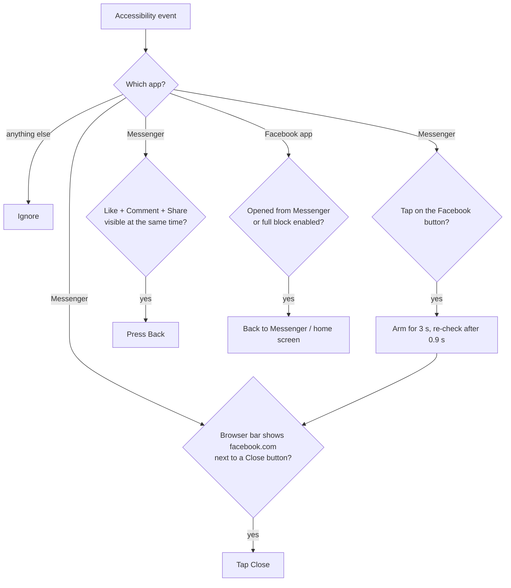

# DoomStop

[](https://github.com/GGrzesiek/DoomStop/actions/workflows/ci.yml)
[](https://github.com/GGrzesiek/DoomStop/releases)
[](LICENSE)

Messenger has a Facebook button. One tap and you are in the feed, and an hour later you are still scrolling.
**DoomStop closes Facebook the moment it opens from Messenger** and puts you back in your chats.
Your Facebook account stays untouched and Messenger keeps working normally.

- Blocks the Facebook button in Messenger (Facebook opened in Messenger's in-app browser)
- Optionally blocks the whole Facebook app, too
- **No `INTERNET` permission**: the app physically cannot send anything off the device
- No runtime dependencies, English and Polish UI

> Android only. iOS does not let apps observe or act on other apps' screens.

## How it works

DoomStop is an Android [`AccessibilityService`](https://developer.android.com/reference/android/accessibilityservice/AccessibilityService).
Android delivers it UI events from all apps (it has to see the Facebook app opening), and the service drops
everything that is not from Messenger or Facebook right away, by package name.



| Layer | Detects | Action |
|---|---|---|
| 1. Entry button | a tap on a Messenger element labelled e.g. `Aplikacja Facebook` | arms the guard, closes whatever opened |
| 2a. In-app browser | the browser bar shows only a Facebook host (`m.facebook.com`) **and** a `Close` button next to it | taps `Close` (Back would only navigate the web history) |
| 2b. Native feed | `Like`, `Comment` and `Share` visible together | Back |
| 3. Facebook app | `com.facebook.katana` / `com.facebook.lite` in the foreground | back to Messenger (or home screen with full block on) |

Every rule is built to avoid false positives in normal chats: labels must match exactly, a Facebook link
sent in a conversation does not look like the browser bar, and feed markers only count as a group.
The rules live in [`Config.kt`](app/src/main/java/io/github/ggrzesiek/doomstop/Config.kt) and are covered by
[unit tests](app/src/test/java/io/github/ggrzesiek/doomstop/ConfigTest.kt).

## Install

1. Download `doomstop-X.Y.Z.apk` from [Releases](https://github.com/GGrzesiek/DoomStop/releases).
2. Open it and allow installing from your browser or file manager when Android asks.
   - **Samsung:** *Auto Blocker* (Settings → Security and privacy) blocks sideloading. Turn it off for the
     install and back on afterwards.
3. Open DoomStop → **Accessibility settings** → DoomStop → turn it on.
   - **Android 13+:** if the toggle is greyed out ("Restricted setting"), go to Settings → Apps → DoomStop →
     ⋮ → **Allow restricted settings** and try again.
4. Set DoomStop's battery usage to **Unrestricted**, otherwise vendor battery savers may kill the service.

Release APKs are signed with the project's release key. A debug build you compiled yourself is signed with your
local debug key, so uninstall one before installing the other.

## Calibration

Messenger's labels change between app versions and languages. If tapping the Facebook icon does nothing:

1. Turn on **Debug mode** in DoomStop.
2. Run `adb logcat -s DoomStop`.
3. Tap the Facebook icon in Messenger. The `CLICK labels=[...]` line shows the button label,
   the `DUMP` block shows the screen that opened.
4. Add the labels to `Config.kt`, add a matching case to `ConfigTest.kt` and rebuild.
5. **Turn Debug mode off.** Dumps can contain chat content.

You can also open a [calibration issue](https://github.com/GGrzesiek/DoomStop/issues/new?template=calibration.yml)
with those log lines (remove any chat content first).

Verified setups:

| Device | Messenger language | Entry button | Browser bar |
|---|---|---|---|
| Samsung Galaxy S24 (One UI) | Polish | `Aplikacja Facebook` | `m.facebook.com` + `Close` |

## Build from source

You need Android Studio (or the Android SDK) and **JDK 17 or 21** for Gradle.

> The Gradle version used here does not run on JDK 25. In Android Studio set
> *Settings → Build, Execution, Deployment → Build Tools → Gradle → Gradle JDK* to 21.

```bash
./gradlew testDebugUnitTest lintDebug assembleDebug
adb install app/build/outputs/apk/debug/app-debug.apk
```

## CI/CD

| Workflow | Trigger | What it does |
|---|---|---|
| [`ci.yml`](.github/workflows/ci.yml) | push to `main`, pull requests | unit tests → Android lint → debug APK, uploaded with test and lint reports as artifacts |
| [`release.yml`](.github/workflows/release.yml) | tag `vX.Y.Z` | checks signing secrets → derives `versionCode` from the tag → tests → builds and signs the release APK → verifies the signature with `apksigner` → publishes a GitHub Release with the APK and its SHA-256 |
| [`dependabot.yml`](.github/dependabot.yml) | monthly | grouped update PRs for Gradle dependencies and GitHub Actions |

Design choices:

- **Least privilege.** CI runs with `contents: read`. Only the release job can write, and only to create the release.
- **Secrets stay out of the repo.** The keystore is decoded into `$RUNNER_TEMP` at run time and deleted at the end.
  Gradle wires up release signing only when the keystore environment variables are present.
- **Supply chain.** `gradle/actions/setup-gradle` validates the Gradle wrapper checksum on every run.
- **Deterministic versions.** `v1.2.3` → `versionName 1.2.3`, `versionCode 10203`. Tags with a suffix
  (`v1.2.3-rc.1`) become pre-releases.

How to cut a release and set up signing: [docs/RELEASING.md](docs/RELEASING.md).

## Privacy

- No `INTERNET` permission, no analytics, no accounts. Nothing leaves the device.
- Screen content is read only from Messenger and Facebook. Events from other apps are discarded by package
  name before anything else happens.
- Settings are stored locally, and Android backup is disabled.
- Debug mode writes to the local logcat only, but it can include chat text. Keep it off outside calibration.

## Limitations

- Detection depends on Messenger's UI labels, so an update can break it until the labels are recalibrated.
- Facebook links that friends send you are closed too, because they open in the same in-app browser.
- Aggressive vendor battery savers can stop the service (see *Install*, step 4).
- Android's Advanced Protection mode blocks accessibility services that are not accessibility tools.
- It is friction, not a lock: you can always switch the service off in settings.

## Ideas

- A countdown ("still want to open Facebook?") instead of a hard block
- Daily time budget and schedules
- The same approach for Instagram Reels and YouTube Shorts

## Disclaimer

DoomStop is an independent project. It is not affiliated with, endorsed by or sponsored by Meta Platforms, Inc.
Facebook and Messenger are trademarks of Meta Platforms, Inc.

## License

[MIT](LICENSE)
